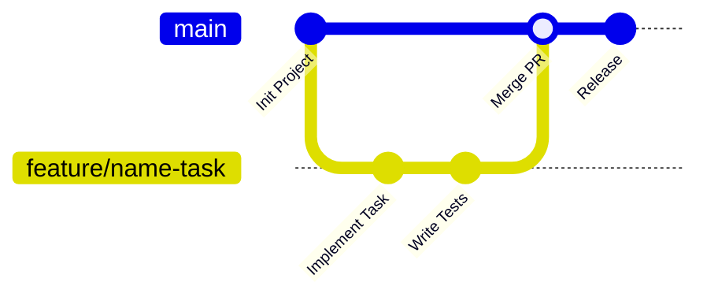

# 📘 HƯỚNG DẪN SỬ DỤNG GIT & GITHUB DÀNH CHO THÀNH VIÊN NHÓM
## DỰ ÁN: RABBIT STREAM CIPHER (RFC 4503) - HỌC PHẦN ET3310

Tài liệu này được biên soạn chi tiết nhằm giúp tất cả các thành viên trong nhóm thống nhất quy trình làm việc trên Git, tránh xung đột mã nguồn (merge conflict), dễ dàng cập nhật code mới nhất từ kho lưu trữ và đẩy đóng góp của mình lên GitHub an toàn.

---

## 📌 THÔNG TIN KHO LƯU TRỮ (REPOSITORY)

- **URL Repository**: `https://github.com/dhdh05/PJ_ET3310_RabbitAlgorithm_eStream.git`
- **Nhánh chính thức (Production Branch)**: `main`
- **Giao thức kết nối**: HTTPS hoặc SSH

---

## 🚀 1. CÀI ĐẶT VÀ CẤU HÌNH BAN ĐẦU (CHỈ CẦN LÀM 1 LẦN)

### Bước 1.1: Cấu hình danh tính Git trên máy tính cá nhân
Mở **Terminal** (macOS/Linux) hoặc **Git Bash / PowerShell** (Windows) và chạy 2 lệnh sau (thay bằng tên và email GitHub của bạn):

```bash
git config --global user.name "Nguyen Van A"
git config --global user.email "your_email@example.com"
```

Kiểm tra lại cấu hình:
```bash
git config --list
```

### Bước 1.2: Lưu mật khẩu / Token truy cập GitHub
Từ tháng 8/2021, GitHub yêu cầu dùng **Personal Access Token (PAT)** thay cho mật khẩu tài khoản thông thường khi đẩy code qua HTTPS:
1. Vào GitHub $\rightarrow$ **Settings** $\rightarrow$ **Developer settings** $\rightarrow$ **Personal access tokens** $\rightarrow$ **Tokens (classic)**.
2. Bấm **Generate new token (classic)**, chọn quyền `repo` và copy lại chuỗi mã Token.
3. Khi Git yêu cầu nhập `Password`, hãy dán chuỗi Token vừa tạo vào.

---

## 📥 2. HƯỚNG DẪN CLONE DỰ ÁN VỀ MÁY TÍNH

Khi bắt đầu tham gia dự án, clone toàn bộ mã nguồn về máy:

```bash
# Di chuyển đến thư mục học tập của bạn, ví dụ:
cd D:/Study/ET3310/

# Clone repository từ GitHub:
git clone https://github.com/dhdh05/PJ_ET3310_RabbitAlgorithm_eStream.git

# Di chuyển vào thư mục dự án vừa tải về:
cd PJ_ET3310_RabbitAlgorithm_eStream
```

Kiểm tra trạng thái hiện tại:
```bash
git status
# Kết quả hiển thị: On branch main, Your branch is up to date with 'origin/main'.
```

---

## 🔄 3. QUY TRÌNH LÀM VIỆC HÀNG NGÀY (DAILY WORKFLOW)

> ⚠️ **QUY TẮC VÀNG**: **TUYỆT ĐỐI KHÔNG CODE TRỰC TIẾP TRÊN NHÁNH `main`!**  
> Nhánh `main` là nhánh ổn định dùng để nộp bài hoặc chạy thử nghiệm chính thức. Mọi tính năng, sửa lỗi hoặc cập nhật báo cáo phải được thực hiện trên nhánh riêng (`branch`).



### Bước 1: Trước khi bắt đầu code, luôn kéo code mới nhất về
Mỗi ngày trước khi làm việc, hãy đảm bảo nhánh `main` ở máy bạn đang chứa code mới nhất mà các bạn khác vừa đẩy lên:

```bash
# 1. Chuyển về nhánh main:
git checkout main

# 2. Kéo code mới nhất từ GitHub về:
git pull origin main
```

### Bước 2: Tạo một nhánh mới cho công việc của bạn
Đặt tên nhánh theo quy ước: `feature/<tên-thành-viên>-<nhiệm-vụ>` hoặc `fix/<tên-thành-viên>-<lỗi>`:

```bash
# Ví dụ thành viên Huy làm tối ưu hóa thuật toán:
git checkout -b feature/huy-optimize-bitwise

# Hoặc thành viên An viết báo cáo readme:
git checkout -b feature/an-update-readme
```

### Bước 3: Chỉnh sửa code và kiểm tra biên dịch
Thực hiện chỉnh sửa file trên VS Code hoặc IDE yêu thích.  
Trước khi lưu lại (commit), hãy chạy thử biên dịch để chắc chắn code không bị lỗi cú pháp:

```bash
cd code
make
# hoặc:
g++ -std=c++14 -O3 -Wall -Wextra -I./include src/rabbit.cpp src/utils.cpp src/file_io.cpp encrypt/encrypt.cpp -o encrypt_app.exe
```

### Bước 4: Kiểm tra trạng thái và thêm file thay đổi
```bash
# Xem các file bạn vừa sửa đổi:
git status

# Thêm các file bạn muốn lưu vào danh sách chờ commit:
git add code/src/rabbit.cpp code/include/rabbit.h

# Hoặc thêm toàn bộ các file đã thay đổi:
git add .
```

### Bước 5: Lưu lại lịch sử thay đổi (Commit)
Viết lời nhắn commit (commit message) ngắn gọn, rõ ràng theo chuẩn:

```bash
# Cú pháp: git commit -m "<hành động>: <mô tả ngắn gọn>"
git commit -m "feat: optimize counter carry propagation using bitwise shift"

# Các tiền tố khuyến nghị:
# feat: Tính năng mới hoặc cải tiến code
# fix: Sửa lỗi logic hoặc lỗi biên dịch
# docs: Cập nhật tài liệu, README, báo cáo
# refactor: Tái cấu trúc thư mục, làm sạch code
# test: Thêm test vectors hoặc đo đạc benchmark
```

### Bước 6: Đẩy nhánh của bạn lên GitHub (Push)
```bash
# Đẩy nhánh lên GitHub (lần đầu tiên chạy nhánh này cần thêm cờ -u):
git push -u origin feature/huy-optimize-bitwise

# Những lần commit tiếp theo trên cùng nhánh này chỉ cần:
git push
```

### Bước 7: Tạo Pull Request (PR) trên GitHub
1. Mở trình duyệt vào link: [https://github.com/dhdh05/PJ_ET3310_RabbitAlgorithm_eStream](https://github.com/dhdh05/PJ_ET3310_RabbitAlgorithm_eStream).
2. GitHub sẽ tự động hiển thị nút màu vàng **Compare & pull request** cho nhánh bạn vừa push. Bấm vào nút này.
3. Điền mô tả ngắn gọn về những gì bạn đã làm.
4. Báo cho trưởng nhóm hoặc thành viên khác vào Review và bấm **Merge pull request** để gộp code vào `main`.

---

## 🛠️ 4. CÁCH ĐỒNG BỘ KHI NHÁNH `main` CÓ CODE MỚI TRONG LÚC BẠN ĐANG LÀM

Nếu bạn đang làm việc trên nhánh `feature/...` mà có thành viên khác vừa merge code mới vào `main`, bạn cần đồng bộ nhánh của mình để tránh bị xung đột sau này:

```bash
# 1. Lưu tạm commit hiện tại của bạn:
git add .
git commit -m "feat: work in progress"

# 2. Cập nhật nhánh main ở máy bạn:
git checkout main
git pull origin main

# 3. Quay lại nhánh của bạn và trộn code mới nhất từ main vào:
git checkout feature/huy-optimize-bitwise
git merge main
```

---

## ⚠️ 5. HƯỚNG DẪN GIẢI QUYẾT XUNG ĐỘT (MERGE CONFLICT)

Xung đột xảy ra khi hai người cùng sửa vào cùng một dòng trên cùng một file. Khi gặp thông báo:
```
CONFLICT (content): Merge conflict in code/src/rabbit.cpp
Automatic merge failed; fix conflicts and then commit the result.
```

**Đừng hoảng loạn! Hãy làm theo 4 bước sau:**

1. **Mở file bị xung đột trên VS Code**:  
   Bạn sẽ thấy Git đánh dấu đoạn code bị tranh chấp như sau:
   ```cpp
   <<<<<<< HEAD (Code hiện tại của bạn)
   uint32_t carry = temp >> 32;
   =======
   uint32_t carry = static_cast<uint32_t>(temp >> 32);
   >>>>>>> main (Code mới từ nhánh main)
   ```
2. **Chọn đoạn code đúng**:  
   Trên VS Code có sẵn các nút bấm tiện lợi:
   - *Accept Current Change*: Giữ lại code của bạn.
   - *Accept Incoming Change*: Lấy code từ nhánh kia.
   - *Accept Both Changes*: Giữ cả hai.
   - Hoặc tự sửa lại bằng tay và xóa các ký tự `<<<<<<<`, `=======`, `>>>>>>>`.
3. **Kiểm tra biên dịch lại**: Chạy `make` hoặc `g++` để đảm bảo code hoạt động trơn tru sau khi giải quyết xung đột.
4. **Lưu và hoàn tất merge**:
   ```bash
   git add code/src/rabbit.cpp
   git commit -m "fix: resolve merge conflict in rabbit.cpp"
   git push
   ```

---

## 🧰 6. BẢNG TRA CỨU NHANH CÁC LỆNH CỨU NGUY (GIT CHEAT SHEET)

| Tình huống cần xử lý | Lệnh thực hiện |
| :--- | :--- |
| **Xem trạng thái các file hiện tại** | `git status` |
| **Xem lịch sử các commit gần nhất** | `git log --oneline -n 5` |
| **Hủy bỏ thay đổi của một file khi chưa `git add`** | `git restore <tên_file>` |
| **Bỏ một file ra khỏi danh sách đã `git add`** | `git restore --staged <tên_file>` |
| **Muốn chuyển nhánh gấp nhưng chưa muốn commit** | `git stash` (Cất code dở) $\rightarrow$ Chuyển nhánh $\rightarrow$ `git stash pop` (Lấy lại code) |
| **Sửa lại lời nhắn commit vừa ghi sai** | `git commit --amend -m "lời nhắn mới"` |
| **Hủy commit gần nhất nhưng vẫn giữ nguyên code** | `git reset --soft HEAD~1` |
| **Xem danh sách tất cả các nhánh** | `git branch -a` |
| **Xóa một nhánh sau khi đã merge thành công** | `git branch -d <tên_nhánh>` |

---

## 🚫 7. CÁC QUY TẮC CẦN TUÂN THỦ TRONG DỰ ÁN

1. **Không đẩy file thực thi (`.exe`, `.out`) và file rác lên Git**:
   - File `.gitignore` của dự án đã được cấu hình để tự động bỏ qua: `*.exe`, `*.o`, `*.obj`, `output/*`, `.vscode/`.
   - Tuyệt đối không dùng `git add -f` để ép đẩy các file thực thi nhị phân lên kho mã nguồn.
2. **Trước khi Push phải Compile**:
   - Đảm bảo code chạy được trên máy của bạn với `g++ -std=c++14` hoặc `make` trước khi tạo Pull Request, tránh đẩy code làm hỏng bản build của cả nhóm.
3. **Commit nhỏ và có ý nghĩa**:
   - Chia nhỏ các thay đổi theo từng chức năng, không nên tích tụ cả tuần rồi mới commit một lần với lời nhắn sơ sài như `update code`.
